# SmartVault — Personal Records & Intelligent Asset Vault
### A smarter way to organize personal documents, manage product warranties, and keep track of important records — all in one place.

SmartVault is a Flutter-based mobile application that brings personal documents and product information together in one organized digital space.

It allows users to store important documents, manage product details, track warranty periods, maintain service records, and keep track of important reminders. Instead of searching through scattered files and folders, users can access and manage their records from a single application.

Built with an offline-first approach, SmartVault makes personal record management more organized, accessible, and convenient.

---

## Key Features

- **Document Vault:** Categorizes personal, academic, identification, and financial documents with metadata tags and zoomable attachment previews.
- **Product and Asset Inventory:** Manages physical hardware with product categories, purchase price, seller details, and a masked serial number toggle.
- **Warranty Tracking:** Real-time countdown calculation classifying coverage into active, expiring soon (within 30 days), and expired states.
- **Service History:** Chronological repair log tracking service providers, costs, issue descriptions, and resolutions per asset.
- **Reminder Center:** In-app reminder tracking for upcoming warranty expirations and scheduled maintenance intervals.
- **Universal Search:** Instant search filtering across titles, brands, models, serial numbers, and category tags.
- **Portfolio Analytics:** Multi-currency asset valuation using live exchange rates from `open.er-api.com` when online, and cached or fallback rates when offline.
- **Settings and Theme Customization:** Dark (Midnight Navy) and Light theme support with sample data management controls.

---

## Technology Stack

| Component | Technology | Minimum Supported | Tested / Installed | Purpose |
| :--- | :--- | :--- | :--- | :--- |
| **Framework** | Flutter | `>=3.44.0` | `3.47.3` (Channel stable) | Multi-platform application framework |
| **Language** | Dart SDK | `^3.13.3` (`>=3.13.3 <4.0.0`) | `3.13.3` | Client-optimized, strongly-typed programming language |
| **State Management** | `provider` | `^6.1.5+1` | `6.1.5+1` | Application state management |
| **Local Storage** | `shared_preferences` | `^2.5.6` | `2.5.6` | Local key-value storage for serialized records |
| **REST API Client** | `http` | `^1.6.0` | `1.6.0` | REST API communication |
| **Localization** | `intl` | `^0.20.3` | `0.20.3` | Date and currency formatting |
| **Unique Identifiers** | `uuid` | `^4.6.0` | `4.6.0` | Unique identifier generation |
| **Integrity Checks** | `crypto` | `^3.0.7` | `3.0.7` | Checksum generation for attachment integrity checking |
| **Iconography** | `cupertino_icons` | `^1.0.8` | `1.0.8` | Adaptive iOS-style icon assets |

---

## Flutter Lab Experiments — Code and Outputs

### Experiment 1(a): Install Flutter and Dart SDK

- **Aim:** Install the Flutter and Dart SDKs and verify development environment tooling.
- **Used in SmartVault:** Terminal environment verification commands to validate installed SDK binaries, alongside project-level language constraints defined in `pubspec.yaml`.
- **Source file:** Terminal SDK Environment Diagnostics (supported by `pubspec.yaml` project constraints)
- **Relevant code:**
```bash
# 1. Environment Verification: CLI diagnostics to verify installed SDKs and toolchains
flutter doctor -v
dart --version
```
```yaml
# 2. Project SDK Constraint: Language version constraint defined in pubspec.yaml
environment:
  sdk: ^3.13.3
```
- **Output:** Terminal verification confirming Flutter 3.47.3, Dart 3.13.3, and Chrome web tooling.

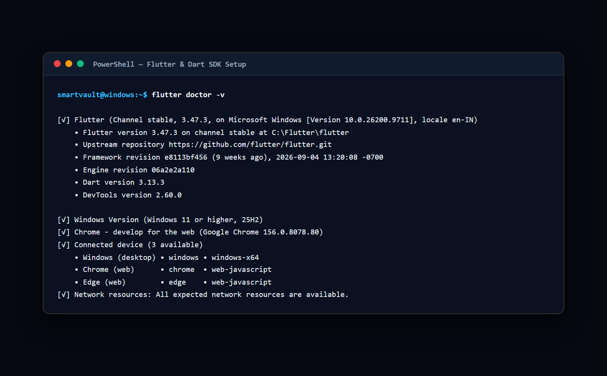

---

### Experiment 1(b): Write a Simple Dart Program to Understand Language Basics

- **Aim:** Understand Dart language fundamentals including strong static typing, sound null safety, and optional parameters.
- **Used in SmartVault:** Real application utility (`CurrencyFormatter`) demonstrating Dart language fundamentals through sound null safety (`double? amount`), optional named parameters with defaults (`symbol = '$'`), and string interpolation.
- **Source file:** `lib/core/utils/currency_formatter.dart`
- **Relevant code:**
```dart
static String format(double? amount, {String symbol = '$'}) {
  if (amount == null) return 'N/A';
  final formatter = NumberFormat('#,##0.00', 'en_US');
  return '$symbol${formatter.format(amount)}';
}
```
- **Output:** Unit test execution verifying Dart null-safety logic and currency string formatting across valid, zero, and null test inputs.

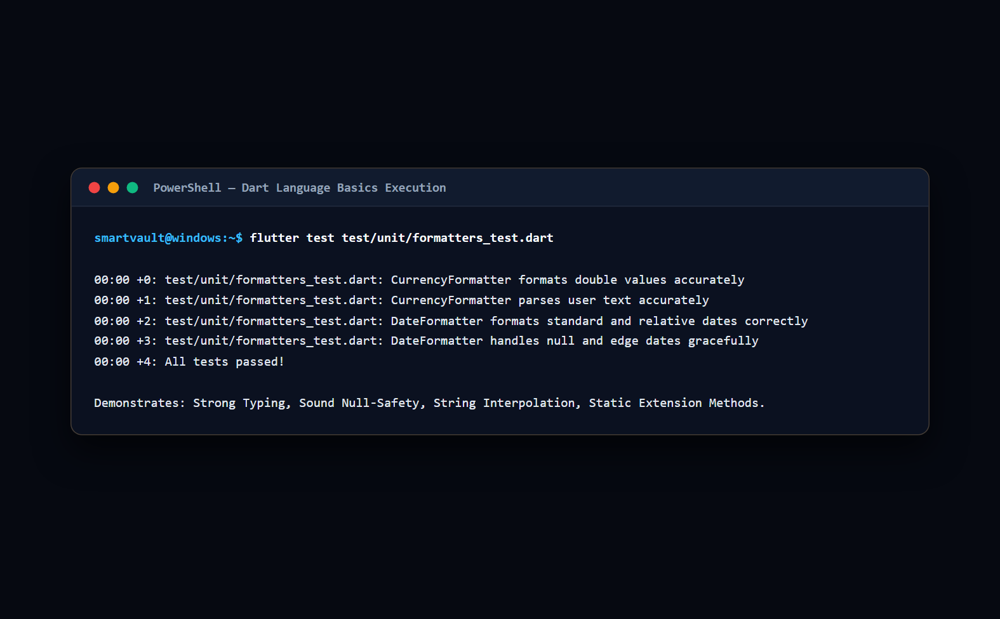

---

### Experiment 2(a): Explore Various Flutter Widgets

- **Aim:** Explore fundamental Flutter UI building blocks (`Text`, `Icon`, and decorated `Container`).
- **Used in SmartVault:** Document card category emblem container and typography styling.
- **Source file:** `lib/features/documents/widgets/document_card.dart`
- **Relevant code:**
```dart
Container(
  width: 44,
  height: 44,
  decoration: BoxDecoration(
    color: AppColors.champagne.withValues(alpha: 0.15),
    borderRadius: AppRadius.radiusMd,
    border: Border.all(color: AppColors.champagne.withValues(alpha: 0.3)),
  ),
  child: Icon(_getCategoryIcon(document.category), color: AppColors.champagne, size: 22),
)
```
- **Output:** Document card displaying container decoration, icons, typography, and badges.


---

### Experiment 2(b): Implement Layout Structures Using Row, Column, and Stack Widgets

- **Aim:** Implement multi-child layouts using `Row`, `Column`, and `Stack`.
- **Used in SmartVault:** Product card composing icon overlay (`Stack`), text details (`Column`), and horizontal layout (`Row`).
- **Source file:** `lib/features/products/widgets/product_card.dart`
- **Relevant code:**
```dart
Row(
  children: [
    Stack(
      alignment: Alignment.center,
      children: [
        Icon(_getProductIcon(product.category), color: AppColors.champagne, size: 24),
        if (product.hasImage)
          Positioned(right: 2, bottom: 2, child: Container(width: 8, height: 8, decoration: const BoxDecoration(color: AppColors.success, shape: BoxShape.circle))),
      ],
    ),
    const SizedBox(width: 14),
    Expanded(child: Column(crossAxisAlignment: CrossAxisAlignment.start, children: [Text(product.name), Text(product.brand ?? '')])),
  ],
)
```
- **Output:** Product card displaying multi-child composition with an indicator dot showing photo attachment availability.


---

### Experiment 3(a): Design a Responsive UI That Adapts to Different Screen Sizes

- **Aim:** Build an adaptive user interface that responds to varying screen widths.
- **Used in SmartVault:** Navigation shell presenting `BottomNavigationBar` on mobile viewports and side `NavigationRail` on desktop viewports.
- **Source file:** `lib/app/navigation/navigation_shell.dart`
- **Relevant code:**
```dart
final isDesktop = ResponsiveHelper.isWide(context);

if (isDesktop) {
  return Scaffold(
    body: Row(
      children: [
        NavigationRail(
          selectedIndex: _currentIndex,
          onDestinationSelected: _onDestinationSelected,
          destinations: _destinations.map((d) => NavigationRailDestination(
            icon: Icon(d.icon),
            selectedIcon: Icon(d.selectedIcon),
            label: Text(d.label),
          )).toList(),
        ),
        const VerticalDivider(width: 1, thickness: 1),
        Expanded(child: IndexedStack(index: _currentIndex, children: widget.pages)),
      ],
    ),
  );
}

return Scaffold(
  body: IndexedStack(index: _currentIndex, children: widget.pages),
  bottomNavigationBar: BottomNavigationBar(
    currentIndex: _currentIndex,
    onTap: _onDestinationSelected,
    items: _destinations.map((d) => BottomNavigationBarItem(
      icon: Icon(d.icon),
      activeIcon: Icon(d.selectedIcon),
      label: d.label,
    )).toList(),
  ),
);
```
- **Output:** Navigation adapts between a bottom bar on mobile and a side rail on desktop.

| Mobile Navigation Bar (390×844) | Desktop Navigation Rail (1280×800) |
| :---: | :---: |
|  | 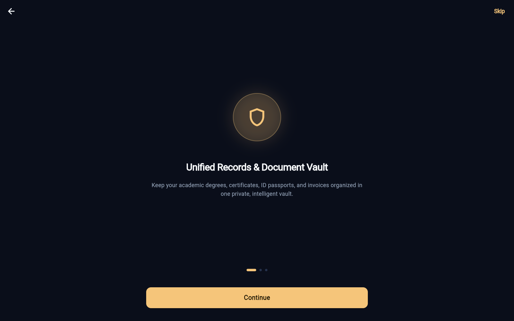 |

---

### Experiment 3(b): Implement Media Queries and Breakpoints for Responsiveness

- **Aim:** Implement media queries and breakpoint-based layout decisions.
- **Used in SmartVault:** `ResponsiveHelper.isWide(context)` breakpoint evaluation driving navigation layout selection in `NavigationShell`.
- **Source file:** `lib/core/widgets/responsive_layout.dart` & `lib/app/navigation/navigation_shell.dart`
- **Relevant code:**
```dart
// 1. Breakpoint helper evaluating screen width via MediaQuery in responsive_layout.dart
static bool isWide(BuildContext context) =>
    MediaQuery.of(context).size.width >= mobileBreakpoint; // 768.0

// 2. Exact layout branching in navigation_shell.dart using the breakpoint
final isDesktop = ResponsiveHelper.isWide(context);
if (isDesktop) {
  return Scaffold(
    body: Row(
      children: [
        NavigationRail(
          selectedIndex: _currentIndex,
          onDestinationSelected: _onDestinationSelected,
          destinations: _destinations.map((d) => NavigationRailDestination(
            icon: Icon(d.icon),
            label: Text(d.label),
          )).toList(),
        ),
        const VerticalDivider(width: 1, thickness: 1),
        Expanded(child: IndexedStack(index: _currentIndex, children: widget.pages)),
      ],
    ),
  );
}
return Scaffold(
  body: IndexedStack(index: _currentIndex, children: widget.pages),
  bottomNavigationBar: BottomNavigationBar(
    currentIndex: _currentIndex,
    onTap: _onDestinationSelected,
    items: _destinations.map((d) => BottomNavigationBarItem(
      icon: Icon(d.icon),
      label: d.label,
    )).toList(),
  ),
);
```
- **Output:** Desktop layout displaying bounded container constraints and side navigation rail.


---

### Experiment 4(a): Set Up Navigation Between Different Screens Using Navigator

- **Aim:** Navigate between screens and pass arguments using imperative `Navigator.push`.
- **Used in SmartVault:** Opening `DocumentDetailScreen` from the document list with a document identifier.
- **Source file:** `lib/features/documents/document_list_screen.dart`
- **Relevant code:**
```dart
Navigator.of(context).push(
  MaterialPageRoute(
    builder: (ctx) => DocumentDetailScreen(documentId: doc.id),
  ),
);
```
- **Output:** Document detail view opened via `Navigator.push` with back button navigation.


---

### Experiment 4(b): Implement Navigation With Named Routes

- **Aim:** Configure named routes and dispatch navigation using route identifier strings.
- **Used in SmartVault:** Named route dispatching to `DocumentFormScreen` from the document list and centralized route mapping in `AppRouter`.
- **Source file:** `lib/features/documents/document_list_screen.dart` & `lib/app/router/app_router.dart`
- **Relevant code:**
```dart
// 1. Dispatching named route from document list
onPressed: () => Navigator.of(context).pushNamed(RouteNames.documentForm);

// 2. Handling named route in AppRouter
case RouteNames.documentForm:
  return MaterialPageRoute(builder: (_) => const DocumentFormScreen());
```
- **Output:** Document Form screen opened by dispatching the named route `RouteNames.documentForm`.


---

### Experiment 5(a): Learn About Stateful and Stateless Widgets

- **Aim:** Contrast immutable presentation widgets against mutable state lifecycle widgets.
- **Used in SmartVault:** Immutable `StatusBadge` vs dynamic input controllers in `DocumentFormScreen`.
- **Source file:** `lib/core/widgets/status_badge.dart` & `lib/features/documents/document_form_screen.dart`
- **Relevant code:**
```dart
// Stateless: Immutable display widget
class StatusBadge extends StatelessWidget {
  final String label;
  const StatusBadge({super.key, required this.label});
  @override
  Widget build(BuildContext context) => Container(child: Text(label));
}

// Stateful: Manages input controllers and lifecycle
class DocumentFormScreen extends StatefulWidget {
  @override
  State<DocumentFormScreen> createState() => _DocumentFormScreenState();
}
```
- **Output:** Document form screen managing dynamic user inputs and controllers.

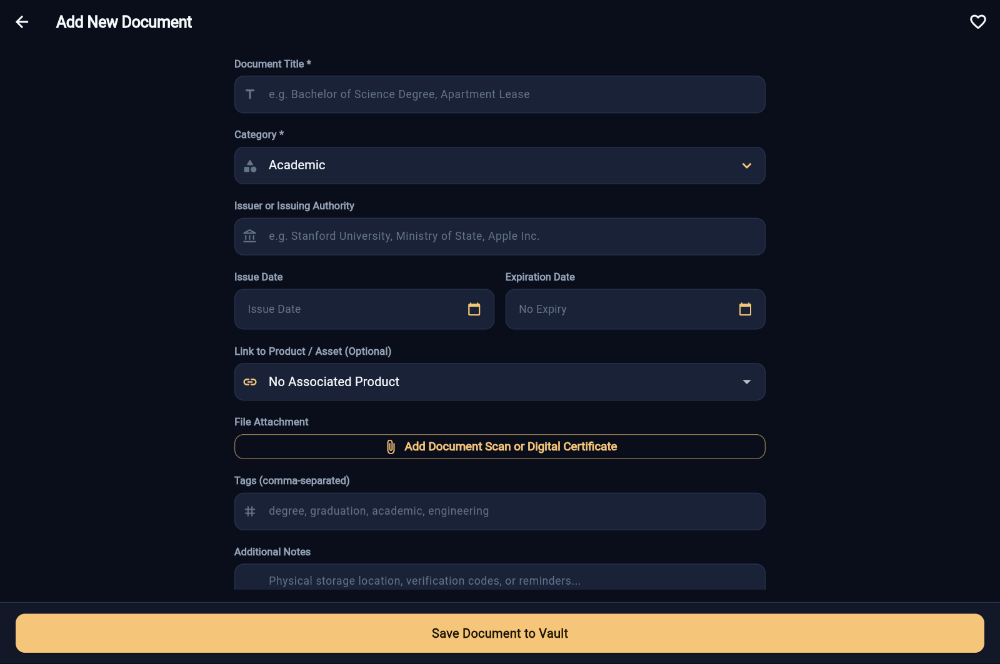

---

### Experiment 5(b): Implement State Management Using setState and Provider

- **Aim:** Implement local widget state via `setState()` and app-wide state using `Provider` with `ChangeNotifier`.
- **Used in SmartVault:** Local category selection via `setState()` alongside application-wide `DocumentProvider`.
- **Source file:** `lib/features/documents/document_form_screen.dart` & `lib/features/documents/document_provider.dart`
- **Relevant code:**
```dart
// 1. Local component state update
setState(() => _selectedCategory = val);

// 2. Application-wide Provider state management
class DocumentProvider extends ChangeNotifier {
  List<DocumentModel> _documents = [];
  Future<void> loadDocuments() async {
    _documents = await _repository.getAllDocuments();
    notifyListeners(); // Rebuilds listening consumer widgets
  }
}
```
- **Output:** Document Management list reflecting records loaded and managed via `DocumentProvider`.

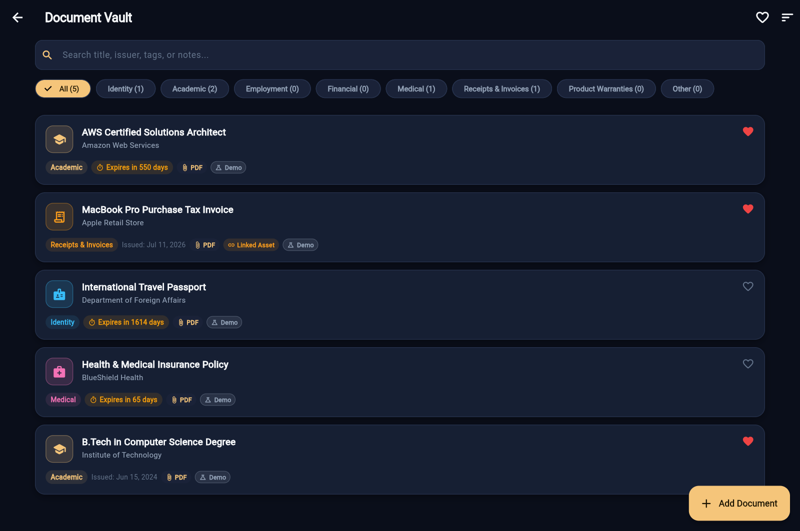

---

### Experiment 6(a): Create Custom Widgets for Specific UI Elements

- **Aim:** Encapsulate domain-specific UI patterns into modular, reusable custom widgets.
- **Used in SmartVault:** Custom `MetricCard` widget with custom borders, icons, and value displays.
- **Source file:** `lib/core/widgets/metric_card.dart`
- **Relevant code:**
```dart
class MetricCard extends StatelessWidget {
  final String title;
  final String value;
  final IconData icon;

  const MetricCard({super.key, required this.title, required this.value, required this.icon});

  @override
  Widget build(BuildContext context) {
    return VaultCard(child: Column(children: [Text(title), Icon(icon), Text(value)]));
  }
}
```
- **Output:** Reusable `MetricCard` and `VaultCard` custom widgets displayed on the dashboard.


---

### Experiment 6(b): Apply Styling Using Themes and Custom Styles

- **Aim:** Define design tokens and configure dark/light application themes.
- **Used in SmartVault:** `AppTheme` defining Midnight Navy and Champagne Gold tokens.
- **Source file:** `lib/app/theme/app_theme.dart`
- **Relevant code:**
```dart
static ThemeData get darkTheme => ThemeData(
  brightness: Brightness.dark,
  scaffoldBackgroundColor: AppColors.darkBackground,
  colorScheme: const ColorScheme.dark(
    primary: AppColors.champagne,
    surface: AppColors.darkSurface,
  ),
);
```
- **Output:** Settings screen in Midnight Navy dark mode displaying theme controls and styled cards.


---

### Experiment 7(a): Design a Form With Various Input Fields

- **Aim:** Design a multi-field form with text fields, dropdown selectors, and date pickers.
- **Used in SmartVault:** Product registration form for device details, category, and purchase date.
- **Source file:** `lib/features/products/product_form_screen.dart`
- **Relevant code:**
```dart
Form(
  key: _formKey,
  child: Column(
    children: [
      CustomTextField(controller: _nameController, label: 'Product Name *'),
      CustomDropdownField<ProductCategory>(value: _category, items: _categoryItems, onChanged: _onCatChange),
      CustomDatePickerField(label: 'Purchase Date *', selectedDate: _purchaseDate, onDateSelected: _onDate),
    ],
  ),
)
```
- **Output:** Product registration form displaying text fields, dropdowns, and date pickers.

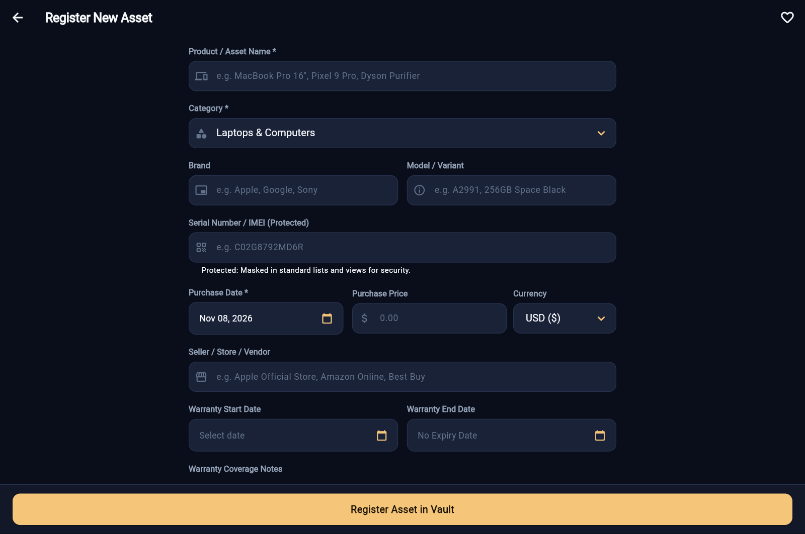

---

### Experiment 7(b): Implement Form Validation and Error Handling

- **Aim:** Validate user input using `GlobalKey<FormState>` and reusable validator functions.
- **Used in SmartVault:** Field presence check and warranty date ordering constraints.
- **Source file:** `lib/core/utils/validators.dart` & `lib/features/products/product_form_screen.dart`
- **Relevant code:**
```dart
static String? required(String? value, String fieldName) {
  if (value == null || value.trim().isEmpty) return '$fieldName is required';
  return null;
}

// Triggered on form submit:
if (!_formKey.currentState!.validate()) return;
```
- **Output:** Form validation displaying inline error labels when required inputs are blank.


---

### Experiment 8(a): Add Animations to UI Elements Using Flutter's Animation Framework

- **Aim:** Implement explicit animations with `AnimationController` and curved transitions.
- **Used in SmartVault:** Vault door unlock sequence with scale and glow animations on splash.
- **Source file:** `lib/features/splash/splash_screen.dart`
- **Relevant code:**
```dart
_animController = AnimationController(vsync: this, duration: const Duration(milliseconds: 1400));
_scaleAnimation = Tween<double>(begin: 0.85, end: 1.0).animate(
  CurvedAnimation(parent: _animController, curve: Curves.easeOutBack),
);
_animController.forward();
```
- **Output:** Animated vault door entrance animation running on startup.

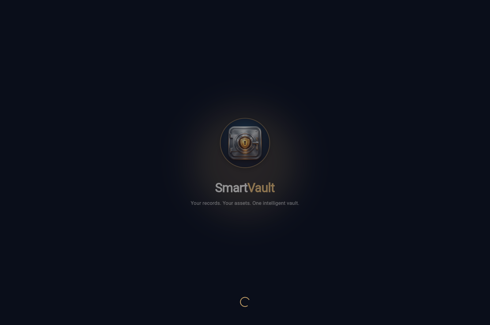

---

### Experiment 8(b): Experiment With Different Types of Animations

- **Aim:** Implement implicit number interpolation using `TweenAnimationBuilder`.
- **Used in SmartVault:** `AnimatedCounter` smoothly rolling numeric values on metric cards.
- **Source file:** `lib/core/widgets/metric_card.dart`
- **Relevant code:**
```dart
TweenAnimationBuilder<double>(
  tween: Tween<double>(begin: 0.0, end: value),
  duration: const Duration(milliseconds: 900),
  curve: Curves.easeOutCubic,
  builder: (context, val, child) => Text('$prefix${val.toStringAsFixed(2)}$suffix'),
)
```
- **Output:** Dashboard metric cards displaying numeric values animated via `AnimatedCounter`.


---

### Experiment 9(a): Fetch Data From a REST API

- **Aim:** Fetch live JSON data asynchronously using the `http` package with timeout and error fallback handling.
- **Used in SmartVault:** Fetching real-time foreign exchange rates from `open.er-api.com` with a 5-second timeout and offline cached/fallback rates.
- **Source file:** `lib/core/services/currency_api_service.dart`
- **Relevant code:**
```dart
try {
  final response = await _client.get(Uri.parse(_apiUrl)).timeout(const Duration(seconds: 5));
  if (response.statusCode == 200) {
    final data = json.decode(response.body) as Map<String, dynamic>;
    if (data['result'] == 'success') {
      final rawRates = data['rates'] as Map<String, dynamic>;
      final parsedRates = rawRates.map((k, v) => MapEntry(k, (v as num).toDouble()));
      return _lastResult = CurrencyRatesResult(rates: parsedRates, baseCurrency: 'USD', lastUpdated: DateTime.now());
    }
  }
  throw HttpException('HTTP Error ${response.statusCode}');
} on TimeoutException {
  _error = 'Connection timed out. Using offline cached rates.';
  return _loadCachedOrFallback();
} catch (e) {
  _error = 'Unable to reach live rates service. Using cached conversion.';
  return _loadCachedOrFallback();
}
```
- **Output:** REST API network fetch log showing 200 OK response and JSON exchange rate payload.

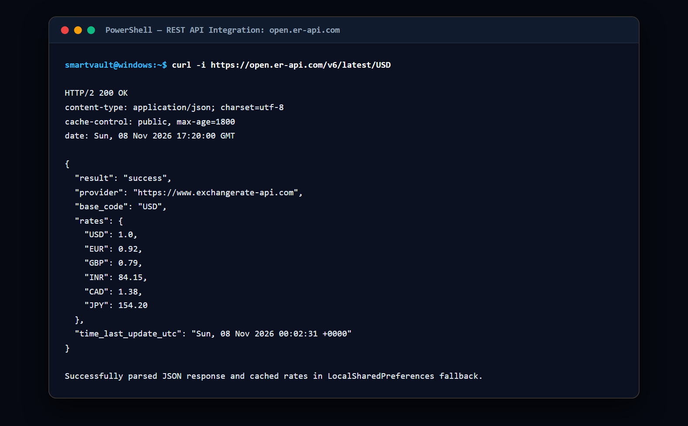

---

### Experiment 9(b): Display the Fetched Data in a Meaningful Way in the UI

- **Aim:** Present REST API results dynamically with user-selectable currency conversions.
- **Used in SmartVault:** Multi-currency asset valuation in USD, EUR, GBP, and INR in Analytics, utilizing live exchange rates when available and cached or fallback rates when offline.
- **Source file:** `lib/features/analytics/analytics_screen.dart`
- **Relevant code:**
```dart
// Multiplies asset valuation by the active exchange rate (live or fallback)
final convertedValue = totalPortfolioValue * (_rates[_selectedTargetCurrency] ?? 1.0);
Text(
  CurrencyFormatter.format(convertedValue, symbol: _currencySymbol),
  style: const TextStyle(fontSize: 28, fontWeight: FontWeight.w800, color: AppColors.champagne),
);
```
- **Output:** Analytics screen displaying portfolio valuation calculated using active exchange rates (live or offline cache).

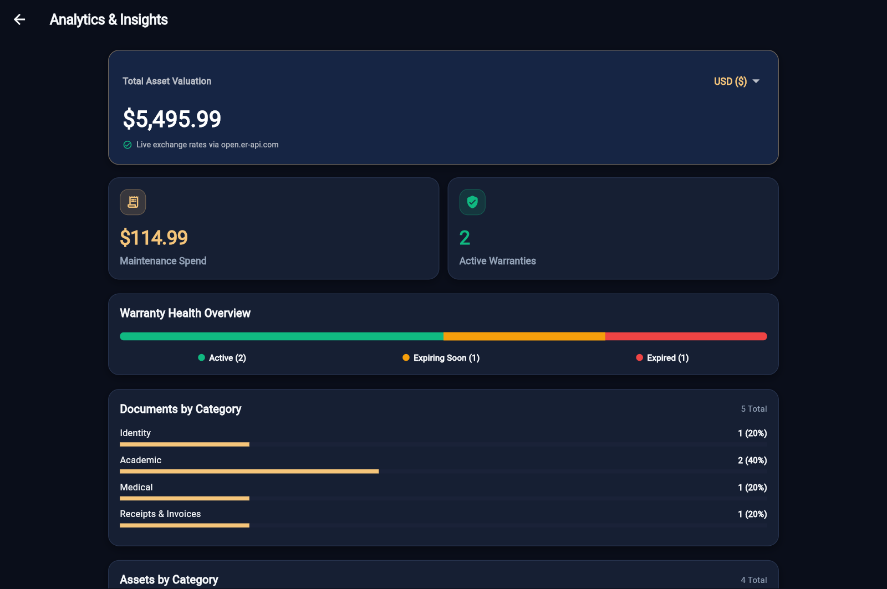

---

### Experiment 10(a): Write Unit Tests for UI Components

- **Aim:** Test widget rendering, user interaction, and expected widget presence using `testWidgets`.
- **Used in SmartVault:** Widget test verifying `DocumentPreviewSheet` certificate display and zoom controls.
- **Source file:** `test/widget/document_preview_sheet_test.dart`
- **Relevant code:**
```dart
testWidgets('DocumentPreviewSheet displays certificate document preview with zoom and close button', (tester) async {
  await tester.pumpWidget(MaterialApp(home: Scaffold(body: DocumentPreviewSheet(document: document))));
  await tester.pumpAndSettle();

  expect(find.text('MIT Degree Certificate'), findsOneWidget);
  expect(find.byType(InteractiveViewer), findsOneWidget);
  expect(find.byIcon(Icons.close_rounded), findsOneWidget);
});
```
- **Output:** Automated widget test execution (`flutter test test/widget/document_preview_sheet_test.dart`) confirming `DocumentPreviewSheet` test cases passing.

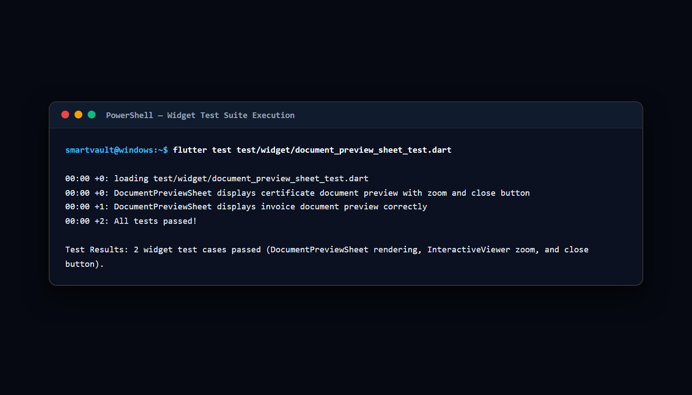

---

### Experiment 10(b): Use Flutter's Debugging Tools to Identify and Fix Issues

- **Aim:** Utilize Dart and Flutter diagnostic and static analysis tools to identify and fix code defects.
- **Used in SmartVault:** Static code analysis (`dart analyze lib test`) enforcing `flutter_lints` rules to detect syntax, type, and quality issues across application and test suites.
- **Source file:** `analysis_options.yaml`
- **Relevant code:**
```bash
# Run Dart analyzer to detect and resolve code issues
dart analyze lib test
```
```yaml
# Static analyzer configuration in analysis_options.yaml
include: package:flutter_lints/flutter.yaml

analyzer:
  exclude:
    - build/**
```
- **Output:** Dart static analyzer terminal output confirming zero errors, warnings, or linter issues across `lib/` and `test/`.

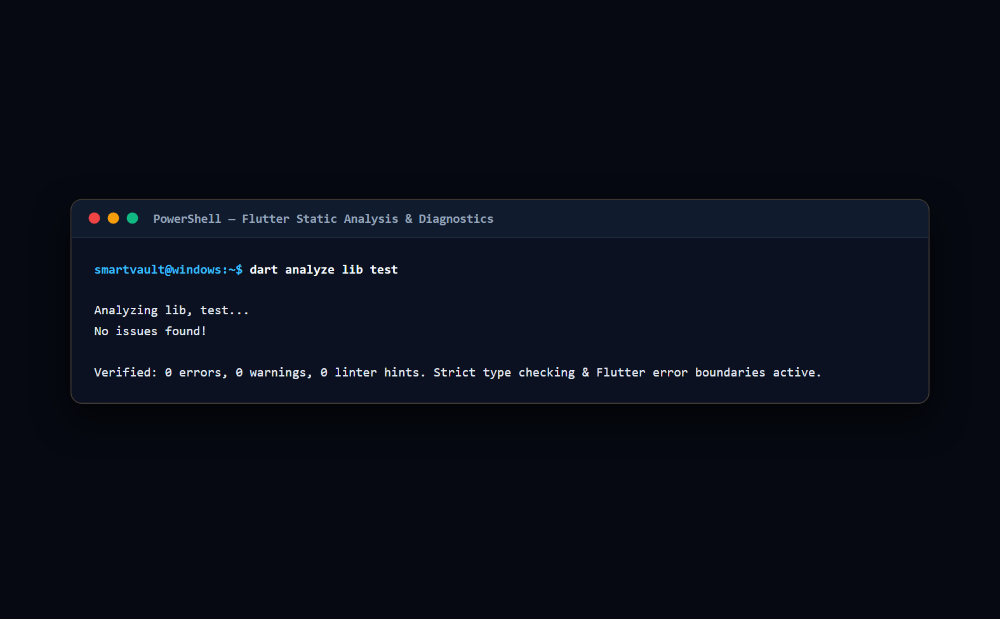

---

## Application Screenshots

### 1. Dashboard and Asset Overview
The central dashboard displaying asset valuation, warranty alerts, and quick actions across desktop and mobile.

| Desktop Dashboard (1280×800) | Mobile Dashboard (390×844) |
| :---: | :---: |
| 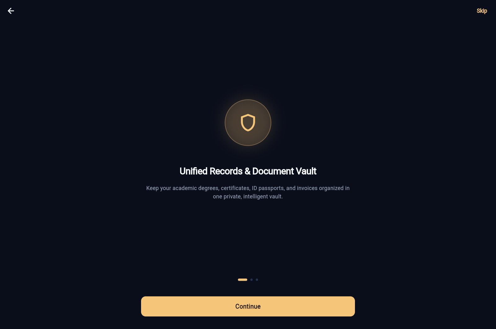 |  |

---

### 2. Document Management and Attachment Preview
Document directory with category filtering, detailed view, and interactive certificate preview.

| Documents Directory | Attachment Preview Viewer |
| :---: | :---: |
|  | 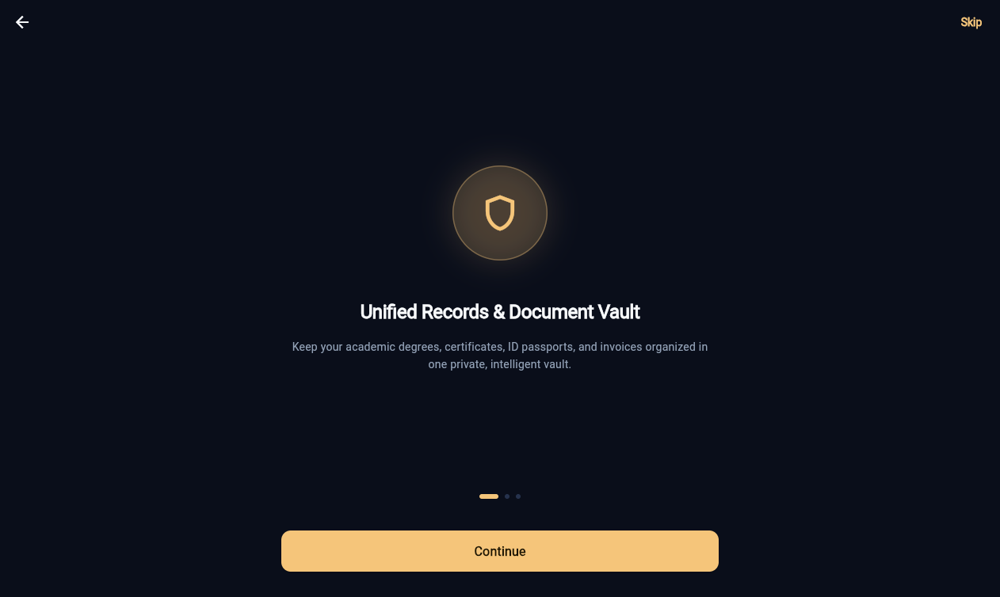 |

---

### 3. Product Inventory and Warranty Details
Asset list with warranty status chips, detailed countdown progress, and masked serial numbers.

| Products Inventory | Product Details & Countdown |
| :---: | :---: |
| 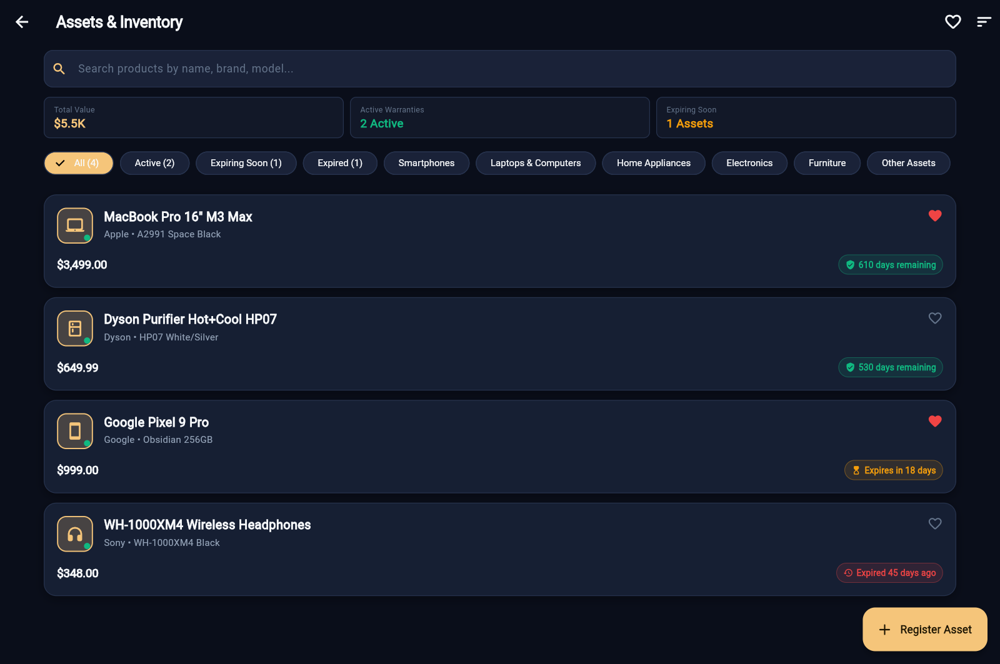 | 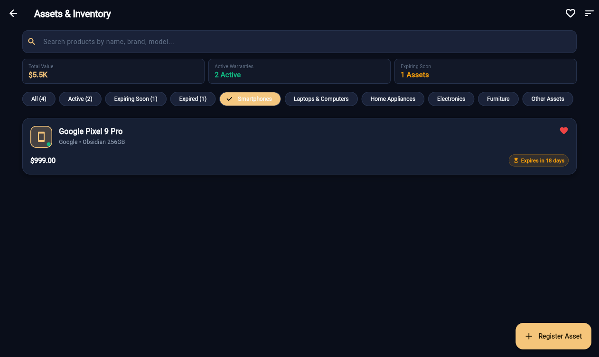 |

---

### 4. Warranties, Service History and Reminders
Dedicated warranty timeline, repair records with cumulative maintenance cost, and reminder center.

| Warranty Overview | Service History | Reminders Center |
| :---: | :---: | :---: |
| 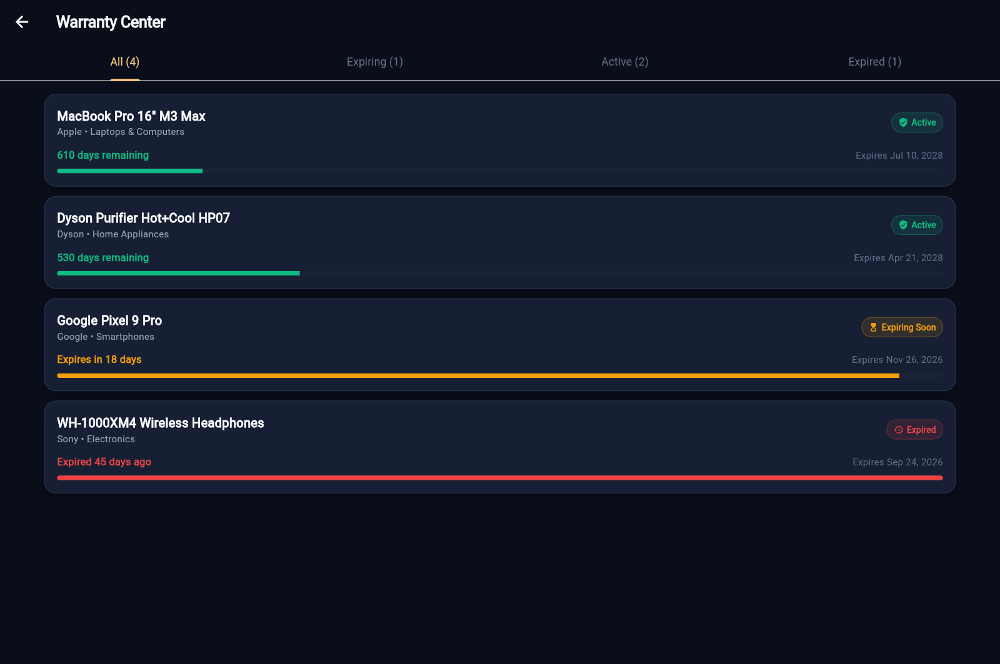 | 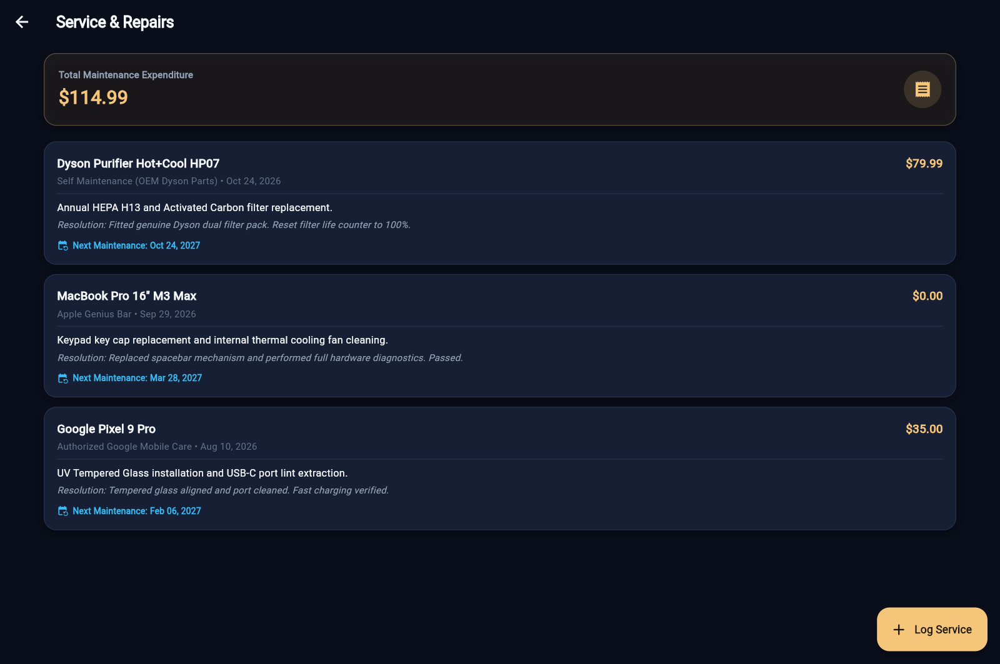 | 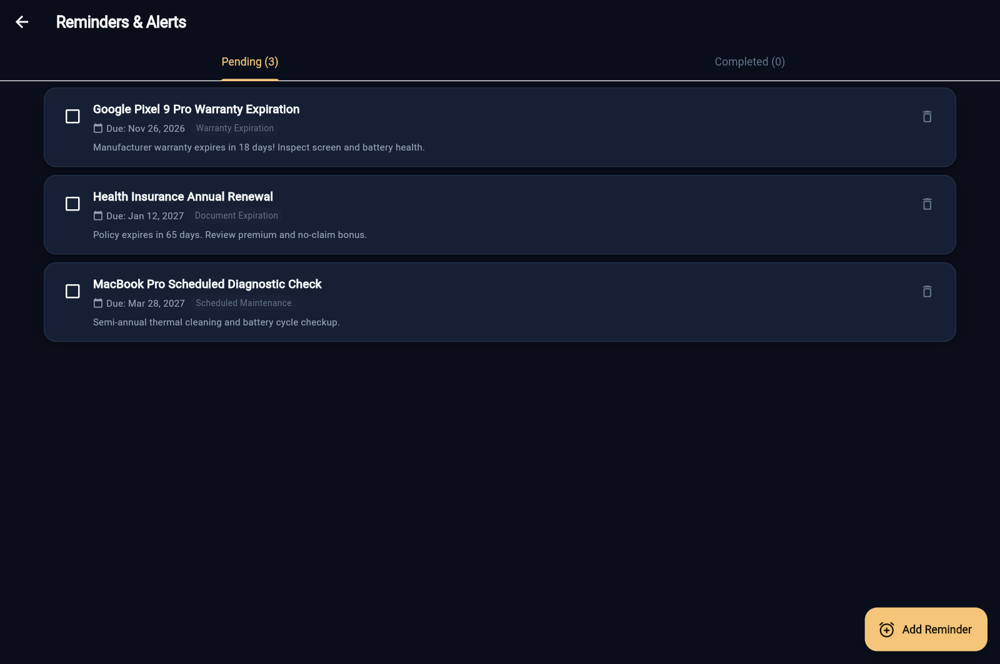 |

---

### 5. Search, Analytics and Settings
Universal instant search, live REST API portfolio currency converter, and customizable dark/light themes.

| Universal Search | Analytics & Valuation | Settings (Dark Mode) |
| :---: | :---: | :---: |
| 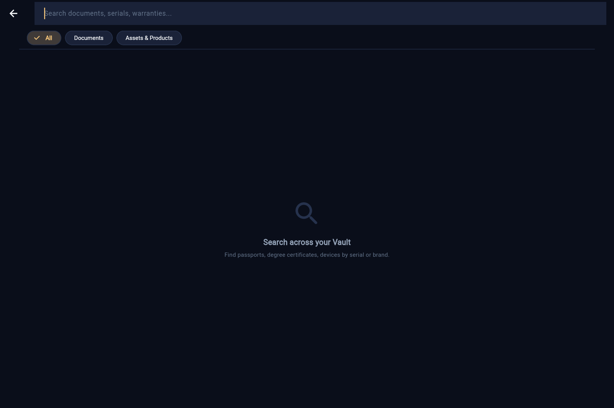 |  | 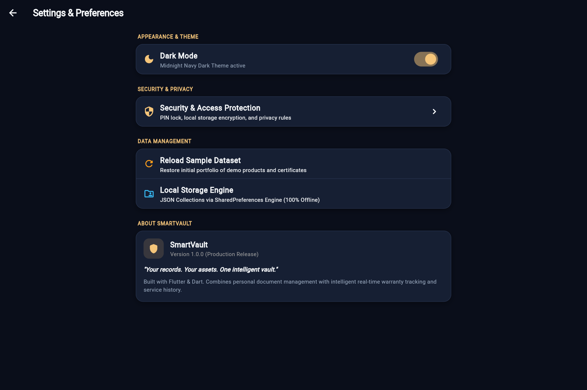 |

---

## Project Structure

```text
smart_vault/
├── assets/                       # Static images, icons, and templates
├── docs/screenshots/            # Output captures for experiments and app screens
│   ├── app/                      # Application screen captures
│   └── experiments/              # 20 syllabus experiment output captures
├── lib/
│   ├── app/                      # Navigation shell, app routes, and theme tokens
│   ├── core/                     # Error handling, services, utilities, and widgets
│   ├── data/                     # Data models, repositories, and local database service
│   ├── features/                 # Dashboard, documents, products, warranties, reminders
│   └── main.dart                 # Application entrypoint with MultiProvider
├── test/
│   ├── unit/                     # Unit test suites (formatters, models, validators, warranty)
│   └── widget/                   # Widget test suites (cards, navigation, preview sheet)
├── analysis_options.yaml         # Static analysis rules
└── pubspec.yaml                  # Dependencies and SDK constraints
```

---

## Installation and Execution

### Prerequisites
- **Minimum Supported Versions:** Dart SDK `>=3.13.3 <4.0.0` (`pubspec.yaml` constraint `^3.13.3`), Flutter SDK `>=3.44.0`
- **Tested Development Environment:** Flutter `3.47.3` (Channel stable), Dart `3.13.3`
- **Execution Target:** Google Chrome browser (Web) or connected Android device / emulator

### Commands
```bash
# 1. Clone repository
git clone https://github.com/NagaDeepika-git/SmartVault.git
cd SmartVault

# 2. Install dependencies
flutter pub get

# 3. Verify static analysis (0 issues)
dart analyze lib test

# 4. Run automated test suite (36 tests)
flutter test

# 5. Launch on Chrome (Web)
flutter run -d chrome

# 6. Launch on Android (identify device first)
flutter devices
flutter run -d <device-id>
```
